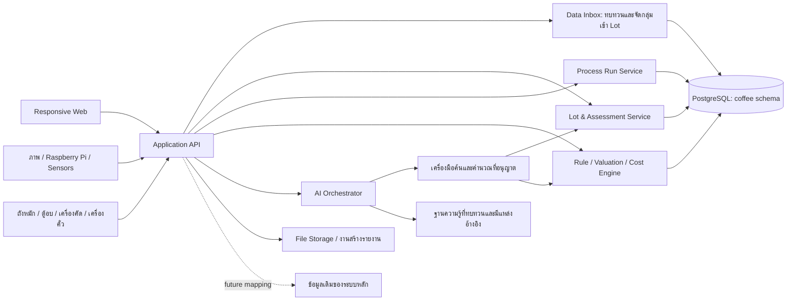
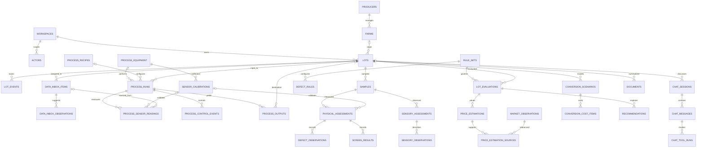

# แผน Web/App, PostgreSQL และ Use Case สำหรับ Coffee AI

สถานะ: แผนและร่างโครงสร้างข้อมูลสำหรับทบทวน ยังไม่สร้างแอป ไม่เชื่อมฐานข้อมูล และไม่รัน migration

วันที่จัดทำ: 11 ตุลาคม 2026

ฐานข้อมูลที่เลือก: **PostgreSQL** ตามที่ผู้ใช้ยืนยัน ไม่ใช้ SQLite

## 1. เป้าหมายและขอบเขต

สร้างระบบช่วยตัดสินใจตั้งแต่รับล็อตกาแฟ ตรวจคุณภาพ ประเมินต้นทุนและราคา เลือกผลิตภัณฑ์ ไปจนถึงจัดทำรายงานและข้อมูลการตลาด โดยทุกผลลัพธ์เชื่อมกลับไปยังล็อต ตัวอย่าง ผลตรวจ และแหล่งข้อมูลที่ใช้

รูปแบบเริ่มต้นเป็น Responsive Web ใช้งานบนมือถือ แท็บเล็ต และคอมพิวเตอร์ ภาษาไทยเป็นหลัก มีคำศัพท์กาแฟภาษาอังกฤษกำกับ ส่วน Native App และการทำงานออฟไลน์เต็มรูปแบบอยู่ระยะถัดไป

ข้อสมมติสำหรับ MVP:

- เริ่มจากกาแฟ Arabica ในประเทศไทย; Washed, Honey, Natural และ Process Run เป็น metadata สำหรับ traceability/จับคู่สินค้า ไม่ใช้ชื่อกระบวนการแทนเกณฑ์เกรดกายภาพ
- เก็บ defect/เมล็ดแตก ผลความชื้น Water Activity และ screen จากการกรอก เครื่องวัด หรือ Data Inbox; ภาพและค่าที่ AI อ่านได้เป็นข้อเสนอให้ตรวจทาน ไม่ใช่ผลยืนยัน
- ไม่ใช้คะแนนชิมในขอบเขตปัจจุบัน; ข้อมูล sensory แบบคำบรรยายใช้ได้เมื่อมีผู้บันทึกและแหล่งที่มาชัดเจน AI ไม่สร้างผลตรวจแทน
- สกุลเงินเริ่มต้น THB ใช้กรัมสำหรับตัวอย่าง กิโลกรัมสำหรับล็อต เมตรสำหรับความสูง และร้อยละสำหรับความชื้น
- โฟกัสข้อมูลสินค้าและ Lot เป็นหลัก; ข้อมูลผู้ใช้/องค์กร/การกำหนดสิทธิ์ยังไม่อยู่ในขอบเขต ส่วนจุดเชื่อมฐานเดิมและขอบเขต workspace ค่อยกำหนดหลังตรวจ schema จริง
- ตรวจ workspace แล้วไม่พบโค้ดหรือ schema เดิม จึงยังไม่ผูกแผนกับโครงสร้างเดิมที่ไม่ได้รับมา

## 2. หลักเกณฑ์ที่ต้องตกลงก่อนเขียนระบบประเมิน

ทะเบียนมาตรฐาน แหล่งวิจัย และบทความแยกตามประเภท พร้อมสถานะความน่าเชื่อถือและขอบเขตการใช้สำหรับระบบค้น/โมเดล: [coffee-standards-and-sources.md](./coffee-standards-and-sources.md)

### 2.1 แยกเกรด 3 เรื่อง

1. **Physical grade:** ผลตามกฎการตรวจสารกาแฟและวิธีสุ่มตัวอย่างที่เลือก
2. **Sensory description:** คำบรรยายจากผู้ประเมินที่ระบุแหล่งข้อมูลได้; ไม่มีคะแนนชิมในขอบเขตปัจจุบัน
3. **Commercial label:** คำทางการค้า เช่น AA, A, Premium หรือ Commercial ซึ่งผูกกับนโยบายผู้ซื้อและแหล่งกำเนิด
ไม่ใช้คำว่า A, AA และ Grade 1 แทนกันอัตโนมัติ; ยังไม่มีนิยาม A/AA ที่ตกลงไว้ กรอบ CVA ของ SCA แยกการประเมินกายภาพ คำบรรยายประสาทสัมผัส ความประทับใจต่อคุณภาพ และข้อมูลประกอบมูลค่าไว้ต่างกัน [SCA Coffee Value Assessment](https://sca.coffee/value-assessment/)

ชื่อ “Specialty Grade 1 / Premium Grade 2 / Commercial Grade 3 / Off-Grade” จากโจทย์จะทำเป็น **business grading profile ที่กำหนดเอง** จนกว่าจะตรวจยืนยัน mapping ของทุกระดับกับมาตรฐานฉบับที่เลือก โดยเฉพาะชื่อ Grade 3 ไม่ควรถูกแสดงเป็นชื่อมาตรฐาน SCA โดยไม่มีหลักฐานรองรับ

### 2.2 ตัวอย่าง 300–350 กรัม

รับข้อมูลได้ทั้ง 300 และ 350 กรัม แต่การอ้างเกณฑ์ SCA ฉบับอ้างอิง 2018 ต้องพิจารณาน้ำหนักตัวอย่าง 350 กรัม รวมถึงเกณฑ์ข้อบกพร่อง Category 1 และ Category 2 ตามเอกสารต้นฉบับ กรณี 300 กรัมให้แสดงผลเบื้องต้นและขอสุ่มใหม่ตาม protocol ห้ามปรับสัดส่วนแล้วใช้ป้ายผลมาตรฐานโดยอัตโนมัติ [SCA Coffee Standards, revised 2018 — สำเนาเอกสารของ SCA](https://editordecafe.com/wp-content/uploads/2019/03/6ec09-coffeestandards-digital.pdf)

จำนวนเมล็ดที่มีตำหนิและจำนวน Full Defect Equivalents ต้องเก็บคนละค่า พร้อม conversion factor และวิธีปัดเศษตาม rule set; การนับหลายตำหนิในเมล็ดเดียวต้องมีวิธีป้องกันนับซ้ำที่ผู้เชี่ยวชาญยืนยัน

### 2.3 Moisture, Screen และความปลอดภัย

- ไม่ใช้ช่วง Moisture เดียวเป็นเกณฑ์สากล: มกษ. 5701-2561 และ 5700-2561 กำหนดไม่เกิน 12.5% โดยมวล; คู่มือ SCAA เดิมระบุ 10–12% สำหรับ Washed coffee ณ เวลานำเข้า; ICO Resolution 420 ระบุ 8–12.5% สำหรับเป้าหมายโครงการส่งออก ระบบจึงต้องให้เลือก rule set ตามสินค้า/ตลาด/วิธีวัดและแสดงแหล่งที่มา พร้อมบันทึกเครื่องมือและเวลาวัด
- Moisture สูงเป็นการแจ้งเตือนความเสี่ยง ไม่ใช่หลักฐานยืนยันว่ามีหรือไม่มีเชื้อรา
- เผื่อฟิลด์ Water Activity และผลทดสอบห้องปฏิบัติการ เพราะความชื้นกับ water activity เป็นคนละตัวชี้วัด [SCA Coffee Standards, revised 2018](https://editordecafe.com/wp-content/uploads/2019/03/6ec09-coffeestandards-digital.pdf)
- เก็บน้ำหนักที่ค้างในแต่ละตะแกรงแบบไม่ซ้อนกันก่อน แล้วคำนวณสัดส่วนสะสม เช่น Screen 18+ ภายหลัง
- ถ้าใช้ A = Screen 16–17 และ AA = Screen 18+ ให้แสดงเป็นช่วงไม่ซ้ำกัน ส่วน “Screen 16+” เป็นค่าสะสมที่รวม 18+ อยู่แล้ว
- AA/A เป็นป้ายตาม commercial screen profile ของแต่ละตลาด ไม่เป็น mapping สากลตายตัว
- ล็อตต้องสงสัยเชื้อรา สารปนเปื้อน หรือปัญหาความปลอดภัยอยู่สถานะ Hold การแนะนำ Instant/RTD ใช้ได้เฉพาะเมล็ดที่ผ่านข้อกำหนดความปลอดภัยและสเปกผู้รับซื้อ

## 3. ขอบเขตข้อมูลผู้ใช้และสิทธิ์

ยังไม่ออกแบบบัญชีผู้ใช้ องค์กร บทบาท หรือระบบสิทธิ์ในระยะนี้ ให้เน้น product data, Lot, defect/เมล็ดแตก, ภาพ และข้อมูล sensor ก่อน เมื่อได้ schema เดิมแล้วจึงกำหนดการเชื่อมและสิทธิ์ร่วมกับระบบหลัก

## 4. หน้าจอ Web/App ที่รองรับทุกฟีเจอร์

### 4.1 Dashboard และรายการล็อต

- จำนวนล็อตตามสถานะ ล็อตรอตรวจ ล็อต Hold ล็อตที่ข้อมูลไม่ครบ และรายการความชื้นนอกช่วง
- ค้นหาด้วย Lot Code, ชื่อล็อต, สวน, แหล่งปลูก, ฤดูเก็บเกี่ยว, กระบวนการ และเกรดกายภาพ
- ตัวกรองช่วงวันที่เลือกได้ว่าอ้างวันที่รับล็อต วันที่วัด หรือวันที่ประเมิน
- เลือกสองล็อตเพื่อเปรียบเทียบ และกดเข้า Lot Workspace

### 4.2 สร้างล็อตและ Lot Workspace

สร้าง Lot จากรายการที่เลือกใน Data Inbox หรือสร้าง Draft เปล่าได้; ระบบเติมข้อมูลที่ยืนยันแล้วให้ก่อน ผู้ใช้กรอกเฉพาะช่องที่ยังขาด ข้อมูลหลักได้แก่ Lot Code, ชื่อ, ผู้ส่งมอบ, สวน/แหล่งปลูก, สายพันธุ์, ความสูง, ฤดูเก็บเกี่ยว, กระบวนการ, สถานะวัตถุดิบ, น้ำหนัก, ราคาที่เสนอ และหลักฐาน

รายละเอียดล็อตแบ่งเป็นแท็บ Overview, Samples & Quality, Process History, Valuation & Costs, Product Plan, AI Chat และ Reports & History

รองรับข้อมูลไม่ครบด้วยสถานะ Draft พร้อมรายการสิ่งที่ยังขาด ไม่ใช้ค่าศูนย์แทนข้อมูลที่ไม่ทราบ

### 4.3 Quality Lab — รองรับ 1.1 และ 1.2

- Wizard: เลือก/สร้างตัวอย่าง → น้ำหนักและ protocol → นับ Defect → วัด Moisture/Water Activity → กรอก Screen → ตรวจข้อมูล → ประเมิน
- แบบนับ Defect แยก Primary/Secondary พร้อมคำอธิบาย หน่วยนับ และ Full Defect Equivalents
- ผลแสดงเกรดกายภาพ แหล่งกฎ รุ่นของกฎ เงื่อนไขที่ผ่าน/ไม่ผ่าน และข้อมูลที่ยังต้องตรวจ
- สถานะผล: ผ่านตามข้อมูลที่ตรวจ, ไม่ผ่าน, ผลเบื้องต้น, ข้อมูลไม่พอ หรือ Hold; ไม่บังคับให้ทุกล็อตต้องได้รับเกรด
- แสดงสัดส่วนตะแกรงทั้งแบบช่วงไม่ซ้ำและแบบสะสม พร้อมตรวจน้ำหนักรวมและ tolerance ตามวิธีชั่ง

### 4.4 Quality Improvement Simulator — รองรับ 1.3

- เลือกเป้าหมายเกรด ทดลองลดตำหนิรายชนิด เปลี่ยนความชื้น หรือเพิ่มข้อมูลที่ขาด
- แสดงทั้งช่องว่าง Defect และเงื่อนไขอื่นที่ยังขวางอยู่ เช่น Primary Defect, น้ำหนักตัวอย่าง และผลตรวจที่ยังขาด
- สรุปเป็น “ต้องลดอย่างน้อย X Full Defect Equivalents และผ่านเงื่อนไข Y/Z” ไม่รับรองการเลื่อนเกรดจากการจำลอง
- แยกจำนวนเมล็ดโดยประมาณออกจากจำนวนจุด Full Defect; ไม่ใช้จุดที่ลดได้จากตัวอย่างคูณตรงเป็นจำนวนเมล็ดทั้งล็อต
- เมื่อคัดจริง ต้องสร้างตัวอย่างและผลประเมินใหม่ เพื่อยืนยันผลหลังคัด

### 4.5 Sensory Notes

- บันทึกคำบรรยายที่ผู้ประเมินให้ไว้ เช่น กลิ่น รส Body และ Aftertaste พร้อมวันที่และ Lot/ตัวอย่างที่อ้างถึง
- แยกข้อสังเกตจากผู้ใช้ ข้อความจากเอกสาร และข้อความที่ AI ร่าง; แสดงที่มาให้เห็น
- ไม่เก็บหรือคำนวณคะแนนชิมใน scope นี้; ใช้คำบรรยายเป็นบริบท ไม่ใช่เกณฑ์คัดเกรดกายภาพ

### 4.6 Valuation & Cost Studio — รองรับ 2.1 และ 2.2

- ประเมินช่วงราคา Green Bean จากแหล่งปลูก กระบวนการ เกรดกายภาพ และธุรกรรม/ใบเสนอราคาที่เปรียบเทียบได้
- แสดงแหล่งอ้างอิง วันที่ จำนวนรายการที่ใช้ น้ำหนักของข้อมูล และสมมติฐานของการปรับราคา
- แยกราคาประกาศขาย ราคาเสนอซื้อ และราคาซื้อขายจริง รวมถึง VAT ค่าขนส่ง และฐานความชื้น
- ถ้าข้อมูลอ้างอิงไม่พอ แสดง “ยังประเมินราคาตลาดไม่ได้” หรือ “Scenario จากสมมติฐานผู้ใช้” แทนสร้างช่วงราคาเอง
- เครื่องคำนวณแปลงสภาพแยก Cherry → Dry Parchment → Green และ Cherry → Dried Cherry → Green สำหรับ Natural
- กำหนด yield แต่ละขั้นได้ เก็บค่าที่คาดการณ์และผลผลิตจริง พร้อมค่าแรง ตาก สี คัด ถุง ขนส่ง และค่าใช้จ่ายอื่น
- แสดงต้นทุนต่อกิโลกรัม Green Bean ราคาคุ้มทุน และผลเมื่อ yield/ราคาขายเปลี่ยน
- หน้าโรงคั่วเพิ่มต้นทุนหลังคั่ว โดยระบุ roast loss และค่าใช้จ่ายแปรรูปในขั้นนั้นต่างหาก

### 4.7 Product & Value Advisor — รองรับ 2.3, 3.1 และ 3.2

- เสนอ Single Origin Filter, Drip Bag, Espresso Blend หรือเส้นทางอุตสาหกรรมตามคุณภาพ รสชาติ ต้นทุน สเปกผู้ซื้อ และความปลอดภัย
- เสนอถุงกั้นอากาศ เช่น GrainPro, Traceability, Storytelling และ Micro-lot พร้อมข้อมูลที่ต้องมีและต้นทุนเพิ่ม
- ไม่ใส่ premium เป็นจำนวนเงินจริงหากไม่มีข้อมูลอ้างอิง ใช้ scenario ที่ระบุสมมติฐานแทน
- ผู้ใช้เลือกเป้าหมายเมนู ระดับคั่ว และราคาขาย แล้วบันทึกเป็นแผนผลิตภัณฑ์
- คำเตือนป้องกันการลดมูลค่าอิงข้อมูลแหล่งที่มา ราคาซื้อ/ขาย และแผนสินค้า; ไม่มี threshold จากคะแนนชิมใน scope นี้
- หากสถานะความปลอดภัยเป็น Hold/Rejected ระบบพักคำแนะนำสำหรับผลิตอาหารจนกว่าจะมีผลยืนยัน

### 4.8 AI Advisor Chat — รองรับ 4.1 และ 5.2

- แชตระดับล็อต พร้อมชิปเลือก Lot/ตัวอย่าง/ผลตรวจหรือคำบรรยายที่กำลังอ้างอิง
- ถามเรื่องคุณภาพ การตาก ต้นทุน การคั่ว การเพิ่มมูลค่า และค้นประวัติด้วยภาษาธรรมชาติ
- คำตอบแนบแหล่งข้อมูล เช่น Lot Code, วันที่ประเมิน, ผลตรวจ/คำบรรยายที่ผู้ใช้บันทึก, รุ่นกฎ และแหล่งราคาที่ใช้
- คำถาม “ผลไม้เด่นแต่ Body ต่ำเพราะอะไร” อธิบายความเป็นไปได้จากข้อมูลที่มี และระบุสิ่งที่ยังต้องถามหรือทดลอง
- คำถาม “ตากฝน 1 วัน ความชื้น 13%” แสดงความเสี่ยง ข้อมูลที่ต้องตรวจ และแนวทางตามฐานความรู้ที่ผ่านการทบทวน
- การค้นใช้ structured filters ผ่าน API ที่อนุญาต ไม่เปิดให้โมเดลรัน SQL อิสระ
- การเปลี่ยนข้อมูลจากแชตมีหน้าทบทวนค่าเดิม/ค่าใหม่ก่อนกดบันทึก การอ่านและสรุปทำได้ทันทีตามสิทธิ์
- เมื่อ AI ใช้งานไม่ได้ ผู้ใช้ยังดูข้อมูลและใช้กฎคำนวณที่ไม่พึ่งโมเดลได้

### 4.9 Lot Comparison — รองรับ 5.1

- เปรียบเทียบสองล็อตทั้งจากหน้าเว็บและคำสั่งในแชต
- แสดงคุณภาพกายภาพ ความเสี่ยง ราคา landed cost, yield, สายพันธุ์, กระบวนการ และความเหมาะสมกับสินค้าที่เลือก
- ระบุงบบาท/กก. หรือวงเงินรวมให้ชัด รวมค่าขนส่ง/ภาษีตามตัวเลือก
- ไม่เทียบราคาผลเชอร์รี่กับสารกาแฟตรง ๆ ต้องปรับเป็นฐานผลิตภัณฑ์เดียวกันก่อน
- ถ้าผลตรวจคนละช่วงเวลา หรือแหล่งข้อมูลไม่ครบ ให้แสดงข้อจำกัดของการเทียบ
- แสดง trade-off ของราคา คุณภาพกายภาพ ความเสี่ยง และเมนูเป้าหมาย โดยไม่สร้างคะแนนรวมที่ยังไม่มีเกณฑ์

### 4.10 Reports & Marketing Studio — รองรับ 4.2 และ 4.3

- ปุ่มสร้าง Executive Summary จากผลประเมินที่เลือก พร้อมเกรดกายภาพ ราคา ต้นทุน ความเสี่ยง สิ่งที่ควรทำต่อ และข้อมูลที่ขาด
- การ์ดสินค้าและคำบรรยายไทย/อังกฤษจากสายพันธุ์ ความสูง แหล่งปลูก กระบวนการ และ Notes ที่มีหลักฐาน พร้อมระดับคั่วที่แนะนำ
- แยก “ระดับคั่วแนะนำ” จาก “ระดับคั่วจริง” บนฉลากสินค้า
- ไม่สร้างชื่อสวน ความสูง ใบรับรอง หรือ Tasting Notes ที่ยังไม่มีข้อมูลยืนยัน
- ผู้ใช้แก้ไขข้อความได้ เก็บรุ่นและผู้อนุมัติ ก่อน Export PDF/ภาพ/ข้อความ
- รายงานเป็น snapshot ระบุผลตรวจที่ใช้และเวลาจัดทำ ไม่เปลี่ยนตามข้อมูลล่าสุดอย่างเงียบ ๆ
- การส่งต่อใน MVP เป็นดาวน์โหลด/คัดลอก; ลิงก์สาธารณะหรือส่งผ่านช่องทางอื่นเป็นระยะถัดไปพร้อมสิทธิ์และวันหมดอายุ

### 4.11 Admin & Data Integration

- จัดการ Rule Set, defect conversion, screen profile, moisture policy, price sources และ conversion defaults
- Import CSV พร้อม preview ตรวจคีย์ซ้ำ ตรวจหน่วย และแสดงข้อผิดพลาดเป็นรายแถว
- จุดเชื่อม workspace/ระบบเดิมไว้ตัดสินใจหลังได้ schema จริง; ยังไม่กำหนดบัญชีผู้ใช้และระบบสิทธิ์
- ข้อมูล rule set ที่ถูกใช้แล้วไม่แก้ทับ ให้สร้างรุ่นใหม่
- หน้าประวัติการเปลี่ยนแปลงและรายการผลที่ควรประเมินใหม่เมื่อข้อมูลต้นทางเปลี่ยน

### 4.12 Process Workbench — บันทึกกระบวนการแปรรูปและเครื่องจักร

หน้าเริ่มต้นเป็นตาราง **Data Inbox** ที่เพิ่ม/แก้/ตรวจทานข้อมูลได้จากจุดเดียว รับภาพถ่าย ผลวัดจาก Raspberry Pi/เซนเซอร์ และข้อมูลที่กรอกเอง โดยแสดงแหล่งอุปกรณ์ เวลา หน่วย สถานะทบทวน และตัวอย่างภาพ ผู้ใช้เลือกหลายรายการแล้วกำหนดให้เป็น Lot เดียวได้; ระบบไม่รวมข้อมูลเป็นล็อตโดยอัตโนมัติ ภาพและค่าที่โมเดลอ่านได้เป็นเพียงข้อเสนอจนกว่าจะมีการยืนยัน

Lot Workspace ใช้แนว IDE: เลือก Lot และข้อมูลอ้างอิง แล้วถาม AI ด้วย prompt สำเร็จรูปหรือพิมพ์เองได้ ส่วนการสั่งเครื่องจักรเป็นคนละการกระทำกับการถามตอบ และต้องบันทึกค่าที่สั่ง ค่าอ่านกลับ สถานะการทำงาน และผู้ยืนยัน

ระบบรองรับ Process Run ที่มีรหัสเครื่อง สูตร/รุ่นสูตร Lot ขาเข้า Lot ผลผลิต น้ำหนัก เวลา และ time-series ของ sensor โดยบันทึก raw reading หน่วยเดิม ค่า normalized วิธีวัด สถานะสอบเทียบ และค่าที่คำนวณต่อ เช่น RoR พร้อมรุ่นอัลกอริทึม:

1. **Controlled Fermentation Tank:** บันทึกเวลา อุณหภูมิมวลกาแฟ pH, °Brix, สูตร/เป้าหมาย และสถานะวาล์วออกซิเจน; บันทึกค่า O₂ จริงเฉพาะเมื่อมีเซนเซอร์ติดตั้ง การแจ้งเตือนใช้ threshold ของสูตรที่ผู้ใช้รับรองและมีเหตุการณ์หยุด/เปิดวาล์วย้อนหลังได้ งานวิจัยกับ Arabica เฉพาะสายพันธุ์และยีสต์รายงานความสัมพันธ์ระหว่างเวลา อุณหภูมิ pH/น้ำตาลกับผล sensory แต่ไม่ได้กำหนดสูตรสากล [SRC-RESEARCH-COFFEE-CONTROLLED-FERMENTATION-2023](https://pubmed.ncbi.nlm.nih.gov/37982081/) สูตรช่วยทดลองสร้าง profile แต่ไม่รับประกันโน้ตไวน์ ดอกไม้ หรือผลไม้ และไม่ทำให้ความเสี่ยง over-fermentation เป็นศูนย์
2. **Hybrid Solar-Electric Dryer:** บันทึกอุณหภูมิ/ความชื้นอากาศ อุณหภูมิเมล็ด ตำแหน่งหรือชั้นตาก พัดลม ฮีตเตอร์ สภาพอากาศ และค่าความชื้นของเมล็ดตามรอบสุ่ม พร้อมตำแหน่งสุ่มและ calibration ของเครื่องวัด capacitance เป้าหมาย 10.5–11.5% เป็น setpoint ของสูตร/ล็อตที่เลือก ไม่ใช่ threshold สากลหรือใบรับรองว่าไม่มีรา/OTA; ระบบแจ้งความเสี่ยงและแนะนำการตรวจยืนยันตามนโยบายแหล่งอ้างอิง งาน hybrid dryer ในกาแฟแสดงว่าอากาศและรูปแบบการให้ความร้อนส่งผลต่อเวลาอบ/ความสม่ำเสมอในเครื่องที่ทดลอง แต่เป็นระบบชีวมวลร่วม solar จึงไม่ใช่ผลรับรองเครื่องฮีตเตอร์ไฟฟ้าแบบนี้ [SRC-RESEARCH-HYBRID-COFFEE-DRYER-2023](https://doi.org/10.1016/j.renene.2023.118961); [Codex CXC 69-2009](https://www.fao.org/input/download/standards/11250/CXP_069e.pdf)
3. **Optical Color & Size Sorter:** บันทึกรุ่นกล้อง/โมเดล ค่าตั้ง Air Ejector ปริมาณเข้า น้ำหนัก/จำนวนเมล็ดที่รับและคัดทิ้ง แยกเหตุผลการคัด และผลร่อน screen เป็นสัดส่วนที่ไม่ซ้ำกัน งานวิจัย hyperspectral NIR แสดงความเป็นไปได้ของการตรวจ defect อัตโนมัติในชุดตัวอย่างที่ทดลอง แต่ไม่ใช่ผลรับรองกล้อง RGB หรือเครื่องทุกยี่ห้อ [SRC-RESEARCH-COFFEE-OPTICAL-DEFECT-2022](https://doi.org/10.1016/j.compag.2022.106970) การตรวจภาพยังมีโอกาสพลาด defect ภายใน ผลคัดเป็นข้อมูลประกอบเท่านั้น ต้องสุ่มตัวอย่างและประเมินกายภาพใหม่ก่อนปรับเกรด; เครื่องคัดไม่รับประกันว่าจะยกระดับ Commercial เป็น Specialty
4. **Automated Hot-Air Roaster:** สร้างล็อตผลผลิตคั่วที่เชื่อมกลับ Lot กาแฟสาร เก็บขนาด batch สูตรและรุ่นเครื่อง เวลา อุณหภูมิเมล็ด/ลม อัตราลม กำลังความร้อน เหตุการณ์สำคัญ น้ำหนักขาออก และ roast loss; คำนวณ RoR จาก time-series โดยเก็บวิธีคำนวณไว้ งานเปรียบเทียบเครื่องคั่ว drum, fluidized-bed และ traditional แสดงว่าชนิดเครื่องและระดับคั่วเป็นตัวแปรของงานทดลอง แต่ไม่ได้พิสูจน์ความเหมือนกันของรสชาติข้าม batch [SRC-RESEARCH-COFFEE-ROASTING-TECHNOLOGIES-2020](https://doi.org/10.1002/fsn3.1904) การบันทึกสูตรและกราฟช่วยควบคุมความแปรปรวนเมื่อเงื่อนไขใกล้เคียง แต่ไม่รับประกันรสชาติซ้ำ 100% และการคั่วไม่เปลี่ยนเกรดกายภาพของกาแฟสารเดิม

การบันทึกและเฝ้าดูอุปกรณ์เป็นระยะแรก ส่วนการควบคุมวาล์ว ฮีตเตอร์ หรือเครื่องยิงลมอัตโนมัติเป็นระยะต่อไป ต้องมี interlock/ขีดจำกัดความปลอดภัยของเครื่องและการทดสอบระบบก่อนเปิดใช้จริง

## 5. สถาปัตยกรรมที่เสนอ

- Frontend: React + TypeScript เป็นตัวเลือกเริ่มต้น ปรับให้ตรงกับระบบหลักก่อนเริ่มพัฒนา
- Backend: API แบบมีสัญญาข้อมูลชัดเจน จะใช้ Python/FastAPI หรือ stack เดิมของระบบ ต้องตัดสินหลังตรวจระบบหลัก
- PostgreSQL เป็นแหล่งข้อมูลหลัก ใช้ schema `coffee` สำหรับโดเมนนี้; จุดเชื่อมกับ schema เดิมกำหนดหลังตรวจโครงสร้างจริง โดยไม่ทำระบบบัญชี/สิทธิ์ซ้ำ
- Rule Engine คำนวณผลเชิงตัวเลขและเงื่อนไข AI รับผลที่คำนวณแล้วไปอธิบาย
- เก็บเอกสาร/ภาพใน file หรือ object storage แล้วบันทึก metadata/key ใน PostgreSQL
- ไม่จำเป็นต้องมี vector database ใน MVP; เพิ่มเมื่อมีเอกสารความรู้ที่ต้องค้นเชิงความหมายจำนวนมาก
- การประเมินและบันทึกผลเป็น transaction เดียว ใช้ request key ป้องกันผลซ้ำจากการกดซ้ำ

## 6. แบบฐานข้อมูล PostgreSQL

ร่าง DDL: [coffee-schema.draft.sql](./coffee-schema.draft.sql)

### 6.1 การเชื่อมระบบเดิม

- ร่าง SQL มี `workspace_id` และ actor reference สำหรับแยกขอบเขต/เก็บที่มาของการแก้ข้อมูล แต่ไม่ได้กำหนดบัญชีผู้ใช้ บทบาท หรือระบบยืนยันตัวตน
- เมื่อทราบ schema เดิม ค่อยตัดสินใจว่าจุดเชื่อมเหล่านี้ใช้คีย์จากระบบหลักหรือปรับให้เหลือเฉพาะคีย์ Lot/ข้อมูลสินค้า
- การย้ายเข้าสู่ระบบจริงต้องทบทวนชื่อ table, identity และนโยบาย retention ร่วมกับฐานเดิม

### 6.2 Master Data และล็อต

- `producers`: ผู้ปลูก/ผู้ส่งมอบและข้อมูลติดต่อที่จำเป็น
- `farms`: สวน แหล่งปลูก จังหวัด/ประเทศ และช่วงความสูง
- `lots`: รหัสล็อต แหล่งปลูก สายพันธุ์ กระบวนการ ฤดูเก็บเกี่ยว สถานะวัตถุดิบ น้ำหนัก และข้อมูลราคาเสนอ
- `lot_events`: เหตุการณ์รับเข้า ตาก สี คัด แบ่งล็อต และการเปลี่ยนสถานะ พร้อมน้ำหนักเข้า/ออกและวันที่
- `samples`: ตัวอย่างจากล็อต น้ำหนัก วิธีสุ่ม วันที่ ผู้สุ่ม และวัตถุประสงค์

ถ้าล็อตผสมจากหลายสวน หรือมีการแบ่ง/รวมล็อต ให้เพิ่ม `lot_origins` และ `lot_lineage` ในระยะถัดไป ไม่บีบข้อมูลหลายแหล่งไว้ในชื่อสวนเดียว

### 6.3 ผลตรวจและกฎ

- `defect_types`: ชนิดตำหนิ คำอธิบาย และหน่วยนับ
- `rule_sets`: ชื่อมาตรฐาน รุ่น ขอบเขตชนิดกาแฟ protocol แหล่งอ้างอิง และกฎที่ใช้จริงแบบ JSONB ที่ตรวจ schema
- `defect_rules`: ระดับ Primary/Secondary, หน่วยต่อ Full Defect และนโยบายการรวม/ปัดเศษ แยกตาม rule set
- `physical_assessments`: ผลตรวจตัวอย่าง ความชื้น Water Activity เครื่องมือ/สถานะ calibration ผู้ตรวจ และเวลาวัด
- `defect_observations`: จำนวนตำหนิที่นับจริงรายชนิด ไม่เก็บเฉพาะยอดรวม
- `screen_results`: เบอร์ตะแกรงและน้ำหนักค้างแบบไม่ซ้ำ รวมถึงถาดรอง
- `sensory_assessments`: บันทึกเชิงพรรณนาโดยผู้ประเมิน; ไม่มีคะแนนรวม/องค์ประกอบเชิงตัวเลข
- `sensory_observations`: descriptor เช่น กลิ่น รส Body และ Aftertaste พร้อมผู้บันทึกและแหล่งที่มา
- `lot_evaluations`: ผลคำนวณแต่ละครั้ง อ้าง assessment และ rule set ที่แน่นอน พร้อม input snapshot, ผลผ่าน/ไม่ผ่าน, grade code, ข้อมูลที่ขาด และสถานะความปลอดภัย

### 6.4 มูลค่า ต้นทุน และคำแนะนำ
ช่วงราคาและเกณฑ์ที่ระบบใช้ต้องมี source record และเงื่อนไขเทียบเคียง; ทะเบียนแหล่งข้อมูลระบุข้อจำกัดและสถานะความน่าเชื่อถือไว้แยกกัน
- `market_observations`: ข้อมูลเสนอซื้อ/ขาย/ธุรกรรมจริง ระบุวันที่ แหล่งอ้างอิง กระบวนการ ชนิดสินค้า ราคา หน่วย และเงื่อนไข
- `price_estimations`: ช่วงราคาของล็อต วิธีประเมิน สมมติฐาน รุ่นวิธีคำนวณ และสถานะความเพียงพอของข้อมูล
- `price_estimation_sources`: ตารางเชื่อมการประเมินราคากับข้อมูลตลาดที่ใช้
- `conversion_scenarios`: น้ำหนักเริ่มต้น เส้นทางการแปรรูป yield แต่ละขั้น ผลผลิตคาดการณ์/จริง และ snapshot สมมติฐาน
- `conversion_cost_items`: ค่าใช้จ่ายรายบรรทัด ระบุประเภทและจำนวนเงิน
- `recommendations`: คำแนะนำเพิ่มมูลค่า เส้นทางผลิตภัณฑ์ ระดับคั่ว และคำเตือน พร้อมเหตุผลจากผลประเมิน

### 6.5 Data Inbox และประวัติกระบวนการ

- `data_inbox_items`: รายการดิบจากภาพ เซนเซอร์ Raspberry Pi หรือการกรอกมือ เก็บแหล่งอุปกรณ์ เวลาที่เกิด เวลาได้รับ สถานะทบทวน payload และ storage key ของไฟล์
- `data_inbox_observations`: ค่าหรือผลที่สกัดจากรายการดิบ เช่น ความชื้น defect และเมล็ดแตก ระบุว่าเป็นค่าจากโมเดลหรือผู้ตรวจ พร้อม confidence, หน่วย, ตำแหน่งบนภาพ และสถานะยืนยัน
- `process_equipment`: เครื่องจักรและอุปกรณ์วัด พร้อมรหัส รุ่น serial และ metadata
- `process_recipes`: สูตรกระบวนการแบบ versioned แยก fermentation/drying/sorting/roasting; Process Run เก็บ snapshot ของสูตรเพื่อรักษาประวัติ
- `sensor_calibrations`: ประวัติการสอบเทียบเครื่องวัด/หัววัดและวิธีอ้างอิง
- `process_runs`: งานแปรรูปแต่ละครั้ง เชื่อม Lot ต้นทาง อุปกรณ์ สูตร เวลา น้ำหนักเข้า และ snapshot ค่าตั้ง
- `process_sensor_readings`: ค่าที่วัด/คำนวณตามเวลา ระบุเครื่องมือ หน่วย แหล่ง inbox และ calibration; ค่า RoR ต้องระบุวิธี/รุ่นที่คำนวณ
- `process_control_events`: ค่าที่สั่งและค่าที่อุปกรณ์ตอบกลับ เช่น วาล์ว O₂, ฮีตเตอร์, พัดลม หรือ air ejector เพื่อทำ traceability; การบันทึก event ไม่ได้เปิดสิทธิ์ควบคุมเครื่อง
- `process_outputs`: สายผลผลิตของแต่ละ run เช่น accepted/rejected/byproduct น้ำหนักและ stage; หากเป็นวัตถุดิบหรือกาแฟคั่วที่ต้องติดตามต่อ ให้สร้าง Lot ปลายทางและเชื่อมไว้

`process_sensor_readings` ใช้ `metric_code`, `value_numeric`, `unit` และ `observed_at` สำหรับทั้ง sensor ใหม่และค่าที่อ่านจาก Raspberry Pi; ตัวอย่างรหัสที่เสนอคือ `mass_temp_c`, `ph`, `brix_deg`, `headspace_o2_pct`, `ambient_rh_pct`, `drying_air_temp_c`, `bean_moisture_pct`, `roast_bean_temp_c` และ `airflow_m3_h`. ค่า RoR เป็น derived metric พร้อมวิธีคำนวณและรุ่น ไม่ใช่ค่าจากหัววัดโดยตรง

การคัดสี/ขนาดและการคั่วอาจสร้าง Lot ลูกที่เชื่อมกลับ Lot แม่ผ่านผลผลิตของ Process Run จึงเก็บ stage และน้ำหนักของแต่ละสายผลผลิตแยกกัน ไม่เขียนทับประวัติของวัตถุดิบต้นทาง

### 6.6 แชต รายงาน และประวัติ

- `chat_sessions`: บทสนทนา ขอบเขตล็อต และเจ้าของบทสนทนา
- `chat_messages`: ข้อความผู้ใช้/AI และ references ที่คำตอบใช้
- `chat_tool_runs`: เครื่องมือและตัวกรองที่ใช้ค้นข้อมูล ผลสำเร็จ/ข้อผิดพลาด และเวลาประมวลผล
- `documents`: Executive Summary/Tasting Card/Comparison Report พร้อม snapshot รุ่นเอกสาร สถานะอนุมัติ และ storage key
- `audit_events`: ใครทำอะไรกับข้อมูลใด เมื่อไร รวมถึงการแก้ไขและ override

### 6.7 ความสัมพันธ์หลัก

### 6.8 ข้อกำหนดข้อมูลและการควบคุม

- ทุกตารางธุรกิจมี `workspace_id` และ timestamp; FK ระหว่างข้อมูลธุรกิจใช้ workspace ร่วมด้วยเพื่อกันอ้างอิงข้ามองค์กร
- ใช้ `NUMERIC` สำหรับน้ำหนัก เงิน และการวัดที่ต้องคำนวณ; ไม่ใช้ float สำหรับยอดเงิน
- ราคาต่อกิโลกรัมกับยอดเงินรวมต้องเป็นคนละฟิลด์ และมี currency/product stage ชัดเจน
- ค่าว่างหมายถึงไม่ทราบ ไม่แปลงเป็น 0 เช่นยังไม่ได้ตรวจ Defect
- ผลตรวจที่ finalized และผลประเมินที่บันทึกแล้วต้องแก้ผ่านรุ่นใหม่; snapshot ทำให้รายงานเก่ายังอธิบายได้
- อนุมัติผลและอนุมัติข้อความการตลาดแยกกัน มีผู้อนุมัติและวันที่
- `lot_code` ไม่ซ้ำภายใน workspace; ตัวอย่างแต่ละตัวมี sample code ไม่ซ้ำภายในล็อต
- ประวัติไม่ถูกลบตามล็อตโดยอัตโนมัติ ใช้ archive และนโยบาย retention
- เพิ่ม index ตาม workspace, lot, วันประเมิน และ product stage เพื่อค้นประวัติได้
- การกำหนดสิทธิ์ฐานข้อมูล/แอปยังอยู่นอกขอบเขต; ก่อนใช้งานจริงต้องเชื่อมระบบ auth และกำหนดการแยกข้อมูลตาม workspace ให้ครบ
- ออกแบบ connection pooling และ backup/restore ร่วมกับฐานข้อมูลส่วนอื่นของระบบ

## 7. หลักการคำนวณ

เก็บเกณฑ์เป็น Rule Set ที่มีรุ่นและข้อมูลกำกับ แทนการฝัง threshold กระจัดกระจายในเงื่อนไข if/else; กฎที่เผยแพร่ต้องระบุขอบเขตและแหล่งอ้างอิง

### 7.1 Grade และ Gap

`Physical Grade = evaluate(measurements, raw defect counts, sample protocol, rule_set_version)`

ตัวอย่างเพื่ออธิบายเท่านั้น: ถ้า profile เป้าหมายใช้เพดาน Secondary 5 Full Defect และล็อตมี 8 โดยไม่มี Primary ช่องว่างด้าน Secondary คือ 3 Full Defect แต่ยังต้องผ่านเงื่อนไขอื่นของ profile และตรวจตัวอย่างใหม่หลังคัด จึงไม่แสดงว่า “คัดอีก 3 เมล็ดแล้วเป็น Specialty แน่นอน”

หากยังมี Primary Defect ให้แสดงว่าเงื่อนไขนั้นยังไม่ผ่าน แม้จำนวน Secondary จะต่ำกว่าเพดานแล้ว

### 7.2 Screen Distribution

`สัดส่วนช่วงตะแกรง (%) = น้ำหนักที่ค้างในช่วงนั้น / น้ำหนักรวมที่ร่อน × 100`

`Screen 18+ (%) = ผลรวมน้ำหนักช่วงตั้งแต่ Screen 18 ขึ้นไป / น้ำหนักรวมที่ร่อน × 100`

ถ้าน้ำหนักรวมไม่สัมพันธ์กับน้ำหนักที่นำไปร่อนเกิน tolerance ให้แจ้งตรวจข้อมูลก่อนสรุป

### 7.3 Conversion และ Break-even

`น้ำหนักออกของขั้น i = น้ำหนักเข้าของขั้น i × yield_i`

`น้ำหนัก Green = น้ำหนักเริ่มต้น × ผลคูณ yield ทุกขั้น`

`ต้นทุนรวม = ค่าวัตถุดิบ + ผลรวมต้นทุนแปรรูปและค่าใช้จ่ายที่เลือก`

`ราคาคุ้มทุน Green ต่อกก. = ต้นทุนรวม / น้ำหนัก Green ที่ขายได้`

ตัวอย่างสมมติ: Cherry 600 กก. อัตรารวม Cherry:Green 5:1–6:1 ให้ Green 100–120 กก. หากค่าวัตถุดิบ 15,000 บาทและค่าแปรรูป 3,000 บาท ต้นทุนคุ้มทุนจะเป็น 150–180 บาท/กก. โดยยังไม่มีค่าใช้จ่ายอื่นนอกตัวอย่าง

อัตรารวม 5:1–6:1 ไม่ถูกนำไปใช้แทน yield ของทุกขั้น กะลาต้องมีอัตราเฉพาะ และ Natural ต้องเลือกเส้นทางที่ตรงกับกระบวนการจริง

หากน้ำหนักขายได้เป็นศูนย์ ข้อมูล yield ขาด หรือไม่มีต้นทุนวัตถุดิบ ต้องไม่แสดงกำไร/คุ้มทุนเสมือนข้อมูลครบ การสูญเสียจากการคัดหรือคั่วนับเพียงครั้งเดียวในขั้นที่เกิด

### 7.4 ราคา

เริ่มจากการคัดรายการเปรียบเทียบที่ฐานสินค้า สกุลเงิน วันอ้างอิง แหล่งปลูก กระบวนการ และคุณภาพสอดคล้องกัน ก่อนคำนวณช่วงและการปรับที่อธิบายได้

MVP ไม่ใช้โมเดลทำนายราคาที่ฝึกเองเมื่อยังไม่มีข้อมูลจริง ใช้ข้อมูลที่นำเข้าและสูตรปรับที่เจ้าของธุรกิจยืนยัน หากข้อมูลไม่พอให้หยุดที่ scenario ไม่ติดป้าย “ราคาตลาดตามจริง”

## 8. Use Case ที่ต้องรองรับ

### UC-01 รับล็อตและสร้างตัวอย่าง

- ผู้ใช้: เกษตรกร, สหกรณ์, นักจัดซื้อ
- เริ่ม: ได้รับล็อตใหม่และข้อมูลแหล่งปลูก
- ขั้นตอน: สร้างล็อต → กรอกข้อมูลและน้ำหนัก → แนบหลักฐาน → บันทึก → สร้างตัวอย่างเพื่อประเมิน
- ทางแยก: Lot Code ซ้ำต้องเลือกล็อตเดิมหรือแก้รหัส; ข้อมูลไม่ครบให้บันทึก Draft
- ผลลัพธ์: ล็อตมีรหัสอ้างอิงและตัวอย่างที่ตามย้อนกลับได้

### UC-02 คัดเกรดและตรวจข้อบกพร่องร้ายแรง

- ผู้ใช้: QC
- ก่อนเริ่ม: มีตัวอย่างและ rule set ที่อนุมัติ
- ขั้นตอน: กรอกผลตรวจ → ตรวจหน่วย/น้ำหนัก → คำนวณ Full Defect → ตรวจ Primary → ประเมินเกรด → บันทึกผล
- ทางแยก: ตัวอย่าง 300 กรัมภายใต้ protocol 350 กรัมได้ผลเบื้องต้น; มีค่าที่ไม่ทราบให้ระบุข้อมูลที่ขาด
- ผลลัพธ์: ผลเกรดพร้อมเหตุผลและรุ่นของกฎ ไม่แก้ทับผลเก่า

### UC-03 พบความชื้นสูงหรือความเสี่ยงความปลอดภัย

- ผู้ใช้: QC, เกษตรกร
- เริ่ม: บันทึกความชื้นนอกช่วงหรือพบหลักฐานต้องสงสัย
- ขั้นตอน: แจ้งเตือน → แยกความเสี่ยงคุณภาพ/ความปลอดภัย → บันทึก Hold หากจำเป็น → บันทึกการแก้ไข → สุ่มและตรวจใหม่
- ทางแยก: ความชื้นสูงเพียงอย่างเดียวไม่ยืนยันเชื้อรา; หากมีปัญหาความปลอดภัยไม่เสนอเป็นวัตถุดิบ Instant/RTD ทันที
- ผลลัพธ์: ประวัติการจัดการความเสี่ยงและเงื่อนไขปลด Hold

### UC-04 จำลองการเลื่อนเกรด

- ผู้ใช้: เกษตรกร, QC
- ก่อนเริ่ม: มีผลประเมินที่ระบุชนิดตำหนิครบ
- ขั้นตอน: เลือกเป้าหมาย → ลดตำหนิใน scenario → ดูช่องว่างที่ยังเหลือ → ประเมินต้นทุนคัด → ตัดสินใจ
- ทางแยก: ถ้ามี Primary หรือเงื่อนไขอื่นยังไม่ผ่าน ให้แสดงเป็นเงื่อนไขคงค้าง
- ผลลัพธ์: แผนคัดและตรวจซ้ำ โดยผลจริงเดิมยังอยู่

### UC-05 ประเมินช่วงราคาเสนอซื้อ

- ผู้ใช้: นักจัดซื้อ, โรงคั่ว
- ก่อนเริ่ม: มีข้อมูลล็อตและข้อมูลตลาดที่เหมาะสม
- ขั้นตอน: เลือกผลประเมิน → กำหนดฐานราคา/วันอ้างอิง → เลือกรายการเปรียบเทียบ → แสดงช่วงราคาและข้อจำกัด
- ทางแยก: รายการเก่า/คนละฐานสินค้า/ข้อมูลน้อยให้เตือนหรือแสดงเพียง scenario
- ผลลัพธ์: ช่วงราคาที่ตรวจกลับไปยังหลักฐานได้ พร้อมจำนวนรายการอ้างอิง

### UC-06 แปลงน้ำหนักและหาจุดคุ้มทุน

- ผู้ใช้: เกษตรกร, สหกรณ์
- ขั้นตอน: ใส่น้ำหนักและราคาต้นทาง → เลือกเส้นทาง → ระบุ yield → ใส่ค่าใช้จ่าย → คำนวณ → บันทึก scenario
- ทางแยก: yield หรือราคาไม่ครบให้แสดงเฉพาะผลที่คำนวณได้; ตัวหารศูนย์ต้องไม่แสดงราคาคุ้มทุน
- ผลลัพธ์: ช่วงผลผลิต ต้นทุนต่อกก. และสมมติฐานที่แก้ไขได้

### UC-07 เลือกสินค้าและรับคำเตือนสูญเสียมูลค่า

- ผู้ใช้: โรงคั่ว
- ขั้นตอน: เลือกล็อต → ระบุเมนู/ระดับคั่ว → ดูคำแนะนำ → รับคำเตือนตามนโยบาย → บันทึกแผนและเหตุผล
- ทางแยก: ล็อต Hold พักเส้นทางอาหาร; คั่วเข้มไม่ได้ถือว่าผิดเสมอไป ต้องดูตลาดเป้าหมายและผลทดลอง
- ผลลัพธ์: Product Plan พร้อมเหตุผลและรายการสิ่งที่ควรทดลอง

### UC-08 ถาม AI เชิงลึก

- ผู้ใช้: ทุกบทบาทที่มีสิทธิ์อ่านล็อต
- ขั้นตอน: ถาม → ระบบระบุบริบท → ค้นข้อมูลและฐานความรู้ → คำนวณด้วยเครื่องมือหากจำเป็น → ตอบพร้อมหลักฐาน
- ทางแยก: ชื่อล็อตซ้ำให้เลือก Lot Code; ข้อมูลไม่พอให้ถามเฉพาะสิ่งที่จำเป็น; เครื่องมือผิดพลาดต้องไม่อ้างว่าค้นพบผลแล้ว
- ผลลัพธ์: บทสนทนาที่เก็บบริบทและแหล่งอ้างอิง

### UC-09 สรุปรายงานล็อตในหนึ่งคลิก

- ผู้ใช้: QC, ผู้จัดการ
- ขั้นตอน: เลือกล็อต/ผลประเมิน → สร้าง Summary → ทบทวน → อนุมัติ → Export
- ทางแยก: ข้อมูลไม่ครบยังสรุปได้แต่ต้องบอกช่องว่าง; ห้ามนำผลตรวจเก่ามาแสดงเป็นผลล่าสุดโดยไม่ระบุวันที่
- ผลลัพธ์: รายงาน snapshot พร้อมผู้จัดทำและผู้อนุมัติ

### UC-10 สร้าง Tasting Card

- ผู้ใช้: โรงคั่ว, การตลาด
- ขั้นตอน: เลือก sensory notes และข้อมูลแหล่งที่มา → เลือกภาษาและระดับคั่ว → สร้างคำบรรยาย → แก้ข้อความ → อนุมัติ → Export
- ทางแยก: ไม่มี Notes/ความสูง/สายพันธุ์ ให้เว้นข้อมูลหรือขอเพิ่ม ไม่แต่งเติมเป็นข้อเท็จจริง
- ผลลัพธ์: ข้อความหน้าถุงและการ์ดที่อ้างกลับไปยังข้อมูลต้นทางได้

### UC-11 เปรียบเทียบสองล็อตภายใต้งบ

- ผู้ใช้: โรงคั่ว, นักจัดซื้อ
- ตัวอย่างคำสั่ง: “เทียบ Lot เทพเสด็จกับดอยช้าง สำหรับ Espresso งบไม่เกิน 300 บาท/กก.”
- ขั้นตอน: ระบุล็อต → ตั้งฐานงบและเมนู → ปรับค่าขนส่ง/สูญเสีย → เปรียบเทียบ → อธิบาย trade-off
- ทางแยก: ถ้าไม่มีล็อตผ่านงบ ให้รายงานตรง ๆ; ชื่อล็อตกำกวมต้องเลือกก่อน; ไม่สร้างคะแนนรวมโดยไม่มีเกณฑ์
- ผลลัพธ์: ข้อเสนอเลือกซื้อพร้อมเหตุผลและสมมติฐาน

### UC-12 ค้นประวัติรายสัปดาห์

- ผู้ใช้: ผู้จัดการ, QC, นักจัดซื้อ
- ตัวอย่างคำสั่ง: “ขอดู Lot ที่ตรวจสัปดาห์นี้และมีผลกายภาพครบ”
- ขั้นตอน: แปลงข้อความเป็นตัวกรอง → ยืนยันชนิดวันที่หากกำกวม → ค้นรายการ → สรุปและเปิด Lot ได้
- ค่าเริ่มต้นที่เสนอ: สัปดาห์จันทร์–อาทิตย์ใน Asia/Bangkok ใช้วันที่ตรวจ/ประเมินและแสดงช่วงวันที่ที่ใช้
- ทางแยก: หากไม่พบผลให้บอกว่าไม่พบตามตัวกรองที่ใช้; ไม่สร้างคะแนนรวมจาก metric ต่างชนิด
- ผลลัพธ์: รายการไม่ซ้ำ Lot พร้อมวันที่และสถานะผลตรวจ

### UC-13 เชื่อมข้อมูลส่วนอื่นและนำเข้าข้อมูล

- ผู้ใช้: ผู้ดูแลข้อมูล/ระบบ
- ขั้นตอน: เลือกองค์กรเดิม → map fields/units → preview → ตรวจข้อมูลซ้ำ → Import แบบ transaction → รายงานผล
- ทางแยก: แถวผิดไม่ถูกแก้หน่วยเองอย่างเงียบ ๆ; external reference ไม่พบให้พักข้อมูลส่วนนั้น
- ผลลัพธ์: ข้อมูลเชื่อมระบบหลักและมีประวัติว่าใครนำเข้าเมื่อใด

### UC-14 รับข้อมูลภาพ/เซนเซอร์และจัดเข้าล็อต

- ผู้ใช้: ผู้รับข้อมูล/QC
- ขั้นตอน: เปิด Data Inbox → กรองตามเวลาและอุปกรณ์ → ตรวจภาพ/ค่าที่อ่านได้ → เลือกหลายรายการ → สร้าง Lot หรือผูก Lot เดิม → ยืนยันการจัดกลุ่ม
- ทางแยก: รายการที่ยังไม่ยืนยันอยู่ใน Inbox; ข้อเสนอจากโมเดลไม่กลายเป็น defect จริงจนกว่าจะตรวจทาน; source event ซ้ำต้องป้องกันการนำเข้าซ้ำ
- ผลลัพธ์: Lot มีข้อมูลต้นทางที่ตามกลับไปยังภาพ อุปกรณ์ เวลาวัด หน่วย และผู้ยืนยันได้

### UC-15 ควบคุม/ติดตามการหมักและการอบแห้ง

- ผู้ใช้: ผู้แปรรูป/QC
- ขั้นตอน: เลือก Lot → เปิด Process Run → เลือกเครื่องและสูตรรุ่นที่อนุมัติ → บันทึกค่าตั้งและ time-series → ดูแนวโน้ม/การแจ้งเตือน → บันทึกผลผลิตและปิดงาน
- ทางแยก: pH, °Brix, อุณหภูมิ หรือความชื้นนอกกรอบสูตรสร้างคำเตือน ไม่ได้ยืนยันโน้ตรสชาติหรือการปลอดเชื้อรา/OTA; ถ้า sensor/calibration ไม่พร้อมให้ระบุค่ามีสถานะ unverified
- ผลลัพธ์: ประวัติ fermentation/drying ที่เชื่อมกับ Lot และรายงานผลผลิต พร้อมข้อมูลสำหรับปรับสูตรรอบถัดไป

### UC-16 คัดแยกสี/ขนาดและยืนยันผลหลังคัด

- ผู้ใช้: ผู้ปฏิบัติงานคัด/QC
- ขั้นตอน: เลือก Lot → บันทึกเครื่อง/โมเดล/ค่าคัด → เดินเครื่อง → บันทึกน้ำหนัก accepted/rejected และเหตุผล → สุ่มตัวอย่างใหม่ → ประเมินทางกายภาพตาม rule set
- ทางแยก: หากผลคัดมีแต่ภาพ ไม่มีผลสุ่มตรวจ ระบบแสดงเป็น process yield ไม่อัปเดตเกรด; หากยังมี Primary Defect ให้คงคำเตือนตาม rule set
- ผลลัพธ์: yield ของแต่ละสายผลผลิตและผลประเมินใหม่ที่มีหลักฐาน ไม่เลื่อนเกรดโดยอัตโนมัติ

### UC-17 คั่วด้วยสูตร Hot-Air และติดตาม batch

- ผู้ใช้: Roast operator/โรงคั่ว
- ขั้นตอน: เลือก Lot สารกาแฟ → เลือกเครื่องและสูตรรุ่น → บันทึกน้ำหนักเข้า/โปรไฟล์และ time-series → คำนวณ RoR พร้อมรุ่นวิธี → บันทึกน้ำหนักออกและ roast loss → สร้าง Lot กาแฟคั่วลูก
- ทางแยก: เครื่อง/ขนาด batch/วัตถุดิบต่างกันให้เตือนว่าการเทียบ curve อาจใช้ตรง ๆ ไม่ได้; ข้อมูล sensor ขาดไม่ให้แสดง RoR ว่าเป็นค่าที่วัดตรง
- ผลลัพธ์: ผลิตภัณฑ์คั่วที่ตามกลับ Lot สารกาแฟและ Process Run ได้ พร้อมประวัติสำหรับตรวจความสม่ำเสมอข้าม batch

## 9. Workflow และสถานะ

สถานะล็อตสำหรับงาน: `draft → received → assessed → reviewed → archived`

สถานะความปลอดภัยเป็นคนละแกน: `unknown / clear / hold / rejected` โดย clear ต้องมีหลักฐานตามนโยบายที่ตกลง ไม่ได้แปลว่าได้รับรองจากหน่วยงานภายนอก

สถานะผลตรวจ: `draft / finalized / superseded`

สถานะผลประเมิน: `provisional / complete / insufficient_data`

สถานะเอกสาร: `draft / approved / superseded`

การประเมินซ้ำสร้างแถวใหม่ อ้างแถวเดิมเป็น superseded ได้ แต่ประวัติและเอกสารเดิมยังอ่านได้ การเปลี่ยนข้อมูลต้นทางให้ขึ้นเครื่องหมายว่าผลเดิมอาจล้าสมัย พร้อมปุ่มประเมินใหม่

## 10. แผนแบ่งระยะ

### ระยะ 0 — ยืนยันกฎและการเชื่อมระบบ

สิ่งส่งมอบ:

- schema/API ของ Lot, product data, ภาพ และ sensor ในระบบที่มีอยู่
- ตัวอย่างล็อตและผลตรวจจริงที่ได้รับอนุญาตให้ใช้
- rule set ที่ผู้เชี่ยวชาญรับรอง รวม thresholds ของทุกเกรด หน่วย Full Defect วิธีปัดเศษ และเงื่อนไขตัวอย่าง
- นิยาม sampling protocol, screen labels, moisture policy และเงื่อนไข Hold/ปลด Hold
- แหล่งราคาที่ใช้งานได้ สิทธิ์ใช้ข้อมูล และนโยบายข้อมูลเก่า
- wireframe ของรับล็อต ตรวจคุณภาพ และ Lot Workspace

### ระยะ 1 — MVP: รับล็อตและประเมินคุณภาพ

- PostgreSQL migrations โดยยืนยันขอบเขตเชื่อมกับระบบเดิมก่อน
- Lot, Farm, Sample, Physical Form, Sensory Notes, Data Inbox และการจัดกลุ่มรายการเข้าล็อต
- บันทึก Process Run/สูตร/ผลผลิตด้วยมือ เพื่อเริ่มเก็บประวัติการหมัก อบแห้ง คัด และคั่ว
- กฎคัดเกรด, Primary warning, moisture/screen validation และ Gap Simulator
- Auto-log ผลประเมิน, ประวัติ, Dashboard และค้นด้วยตัวกรอง
- Executive Summary จากผลตรวจที่เลือก

เกณฑ์จบ: ผู้ใช้รับหนึ่งล็อต บันทึกตัวอย่าง ประเมิน ดูเหตุผล ตรวจซ้ำ และ Export รายงานได้ครบ โดยประวัติเดิมยังอยู่

### ระยะ 2 — ซื้อขายและเลือกผลิตภัณฑ์

- Market data import, price estimation ที่มีหลักฐาน และ conversion/cost calculator
- Product Matching, Value-add และ Anti-downgrade policy
- เปรียบเทียบสองล็อตภายใต้งบและเมนู

เกณฑ์จบ: ผู้ใช้เปรียบเทียบล็อตบนฐานต้นทุนเดียวกัน และอธิบายที่มาของข้อเสนอซื้อ/ขายได้

### ระยะ 3 — AI Chat และการตลาด

- AI tools สำหรับค้นล็อต อ่านผลประเมิน คำนวณ และค้นประวัติ
- ฐานความรู้ที่ทบทวน, citations และการจัดการข้อมูลไม่ครบ
- Tasting Card, คำบรรยายสินค้า, report templates และการอนุมัติข้อความ

เกณฑ์จบ: คำถามตัวอย่างตอบได้จากข้อมูลจริงพร้อมอ้างอิง และไม่แต่งผลตรวจ

### ระยะ 4 — ขยายการใช้งาน

- PWA/offline queue พร้อม conflict resolution, ingest ภาพ/Raspberry Pi/เซนเซอร์โดยตรง และเชื่อมอุปกรณ์ทั้งสี่ประเภท
- ทดลอง automation ของวาล์ว/ฮีตเตอร์/พัดลม/air ejector แบบมี interlock และทดสอบความปลอดภัยก่อนเปิดสั่งงานจริง
- หลายสวนต่อล็อต, split/merge lineage, inventory และข้อมูลการผลิตจริง
- เชื่อมแหล่งราคาภายนอก, ระบบจัดซื้อ/ขาย, public traceability และ model ราคาหากข้อมูลเพียงพอ

ไม่กำหนดระยะเวลาเป็นสัปดาห์จนกว่าจะทราบขนาดทีม ระบบหลัก ปริมาณข้อมูล และคุณภาพข้อมูลอ้างอิง

## 11. Acceptance Criteria สำหรับใช้เมื่อเริ่มพัฒนา

รายการนี้เป็นแผนตรวจรับ ยังไม่ได้รันทดสอบหรือสร้างระบบจริง

- ตัวอย่างที่ผิด protocol ไม่ได้ป้ายผลมาตรฐานเต็มรูปแบบ
- การนับ Primary/Secondary ใช้ conversion และ rounding ของ rule set ที่บันทึกไว้
- กฎทุกระดับมีหลักฐาน/ผู้อนุมัติก่อนเผยแพร่ ไม่อนุมานช่วง Grade 2–Off-Grade จากชื่ออย่างเดียว
- Screen ไม่ถูกนับซ้ำ และน้ำหนักผิด tolerance ต้องถูกแจ้ง
- Gap ไม่รับรองผลหลังคัดก่อนตรวจซ้ำ และไม่ข้ามเงื่อนไข Primary
- ไม่มีข้อมูลราคาเปรียบเทียบที่พอใช้แล้วระบบไม่สร้างราคาตลาดขึ้นเอง
- สูตร conversion ไม่ใช้ ratio รวมแทน ratio ทุกขั้นและไม่หารด้วยศูนย์
- ล็อต Hold/Rejected ไม่ได้รับข้อเสนอไปเป็นวัตถุดิบอาหารโดยไม่มีเงื่อนไขปลดสถานะ
- การเชื่อมสิทธิ์ข้อมูลกับระบบหลักต้องตกลงก่อนเปิดให้ใช้งานหลายองค์กร; ไม่สร้างระบบบัญชีซ้ำใน Coffee AI
- กดประเมินซ้ำด้วย request key เดิมไม่สร้างผลซ้ำ
- รายงานเก่ายังอ้างผลตรวจและกฎเดิมได้หลังมีการประเมินใหม่
- ประวัติรายสัปดาห์ใช้เขตเวลาและฐานวันที่ที่แสดงให้ผู้ใช้ทราบ
- Tasting Card ไม่สร้าง Notes/แหล่งปลูก/ใบรับรองที่ไม่มีข้อมูลยืนยัน
- รายการภาพ/เซนเซอร์ที่ยังไม่ทบทวนไม่ถูกผูกกับ Lot; detection จากโมเดลไม่ถูกนับเป็น defect ที่ยืนยันแล้ว
- ผลวัดความชื้นจาก capacitive sensor ระบุเครื่อง/สถานะ calibration และ rule source ที่ใช้เตือน
- Process Run ทั้งสี่แบบเก็บอุปกรณ์ สูตรรุ่น ค่าที่วัด และผลผลิตแยกจาก Lot ต้นทาง; ค่า RoR แสดงว่าเป็นค่าคำนวณพร้อมรุ่นวิธี
- ผลคัดแยกไม่ปรับเกรดจนกว่าจะมี sample และ physical assessment ใหม่; ผลอบแห้งไม่ยืนยันว่าไม่มี OTA
- Lot กาแฟคั่วเชื่อมย้อนกลับไปยัง Lot สารกาแฟและบันทึกน้ำหนักเข้า/ออกได้
- การสำรองและกู้คืนครอบคลุม PostgreSQL และไฟล์แนบที่สัมพันธ์กัน

## 12. ประเด็นที่ยังต้องได้ข้อมูลก่อนเริ่ม implementation

1. schema/API ของระบบเดิม โดยเฉพาะ lot, supplier, inventory และ purchase เพื่อเชื่อมคีย์สินค้าและไม่สร้างข้อมูลซ้ำ
2. กาแฟและตลาดแรกที่จะใช้จริง รวม Arabica/Robusta และนโยบายเกรดของผู้ซื้อ
3. เอกสารมาตรฐานและตัวอย่างการนับ Defect ที่จะใช้อนุมัติ rule set
4. แหล่งราคาและความหมายของราคาเป้าหมาย เช่น หน้าสวน ส่งถึงโรงคั่ว รวม/ไม่รวมภาษี
5. ปริมาณล็อต/telemetry และวิธีติดตั้งระบบ รวมผู้ให้บริการ AI ที่อนุญาตให้นำข้อมูลล็อตไปประมวลผล

สามารถเริ่มจากระยะ 0 ได้โดยใช้แผนนี้และร่าง SQL เป็นเอกสารทบทวน ไม่ต้องรอการเลือกทุกฟีเจอร์ของระยะขยาย
